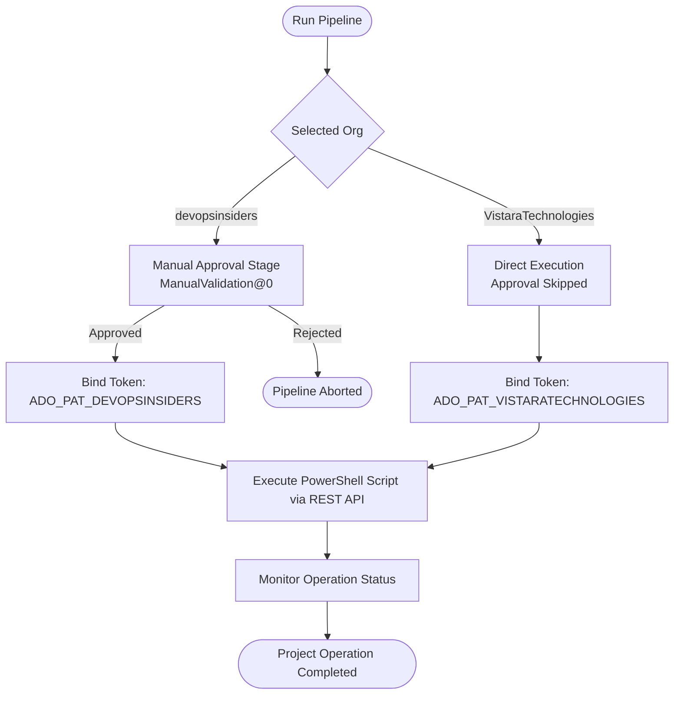

# Azure DevOps Project Lifecycle Management

Automated, enterprise-grade Azure DevOps pipelines and PowerShell automation scripts for provisioning and renaming Azure DevOps projects across multiple organizations (`devopsinsiders` and `VistaraTechnologies`).

---

## Architecture Overview



---

## Features

- **Multi-Organization Support**: Choose the target organization (`devopsinsiders` or `VistaraTechnologies`) directly from a dropdown menu in the pipeline run UI.
- **Conditional Governance & Approval**:
  - `devopsinsiders`: Enforces a manual approval gate before running any project-level operations.
  - `VistaraTechnologies`: Runs directly without approval bottlenecks.
- **Secure Multi-Token Resolution**: Dynamically maps organization-specific Personal Access Tokens (PATs) at compile-time without exposing secrets in logs.
- **Decoupled Architecture**: Clean segregation between pipeline orchestration (YAML) and core automation logic (modular PowerShell scripts).
- **Validation & Asynchronous Monitoring**: Pre-flight validation checks (existence, collisions, state) followed by polling Azure DevOps asynchronous operation APIs until completion.

---

## Repository Structure

```text
.
├── ado-project-create.yml            # Pipeline: Azure DevOps project creation
├── rename-ado-project.yml            # Pipeline: Azure DevOps project renaming
├── scripts/
│   ├── create-ado-project.ps1        # PowerShell script: REST API project creation & polling
│   └── rename-ado-project.ps1        # PowerShell script: REST API project rename & verification
└── README.md                         # Documentation
```

---

## Prerequisites & Configuration

### 1. Azure DevOps Library (Variable Group)

Create a variable group named **`ADO-Secrets`** under **Pipelines > Library** in your Azure DevOps project.

Add the following secret variables:

| Variable Name | Description | Secret? |
| :--- | :--- | :---: |
| `ADO_PAT_DEVOPSINSIDERS` | Personal Access Token for the `devopsinsiders` organization | **Yes** |
| `ADO_PAT_VISTARATECHNOLOGIES` | Personal Access Token for the `VistaraTechnologies` organization | **Yes** |

### 2. PAT Token Permissions

Each Personal Access Token requires the following minimum scopes:
- **Project and Team**: `Read, write, & manage`

---

## Pipelines Guide

### 1. Create Azure DevOps Project (`ado-project-create.yml`)

Provisions a new private project in the selected organization with Git version control and the Agile process template.

#### Parameters:
- `organization`: Target organization (`devopsinsiders` or `VistaraTechnologies`).
- `projectName`: Name of the new project to create.

#### Execution Flow:
1. **Approval Gate (devopsinsiders only)**: Pauses for manual review via `ManualValidation@0`.
2. **Pre-Check**: Checks if a project with the same name already exists. If it exists, the pipeline exits safely with status `AlreadyExists`.
3. **Creation**: Submits a `POST` request to `/_apis/projects`.
4. **Operation Polling**: Monitors the background operation ID until the status returns `succeeded`.

---

### 2. Rename Azure DevOps Project (`rename-ado-project.yml`)

Renames an existing Azure DevOps project with safety verifications.

#### Parameters:
- `organization`: Target organization (`devopsinsiders` or `VistaraTechnologies`).
- `existingProjectName`: Current name of the project.
- `newProjectName`: New desired name for the project.

#### Execution Flow:
1. **Approval Gate (devopsinsiders only)**: Pauses for manual review via `ManualValidation@0`.
2. **Pre-Check Existing Project**: Verifies that `existingProjectName` exists and is in a `wellFormed` state.
3. **Name Availability Check**: Verifies that `newProjectName` is not already in use.
4. **Rename**: Submits a `PATCH` request to `/_apis/projects/{projectId}`.
5. **Operation Polling**: Monitors operation status until completed.
6. **Post-Verification**: Verifies that the project URL and name match the new target name.

---

## Local Script Usage (Testing)

You can also run the PowerShell scripts locally for testing or maintenance by setting the `ADO_PAT` environment variable:

### Create Project:
```powershell
$env:ADO_PAT = "<your-pat-token>"

.\scripts\create-ado-project.ps1 `
    -Organization "devopsinsiders" `
    -ProjectName "Test-Project"
```

### Rename Project:
```powershell
$env:ADO_PAT = "<your-pat-token>"

.\scripts\rename-ado-project.ps1 `
    -Organization "devopsinsiders" `
    -ExistingProjectName "Test-Project" `
    -NewProjectName "Test-Project-Renamed"
```
